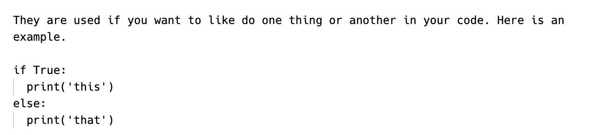
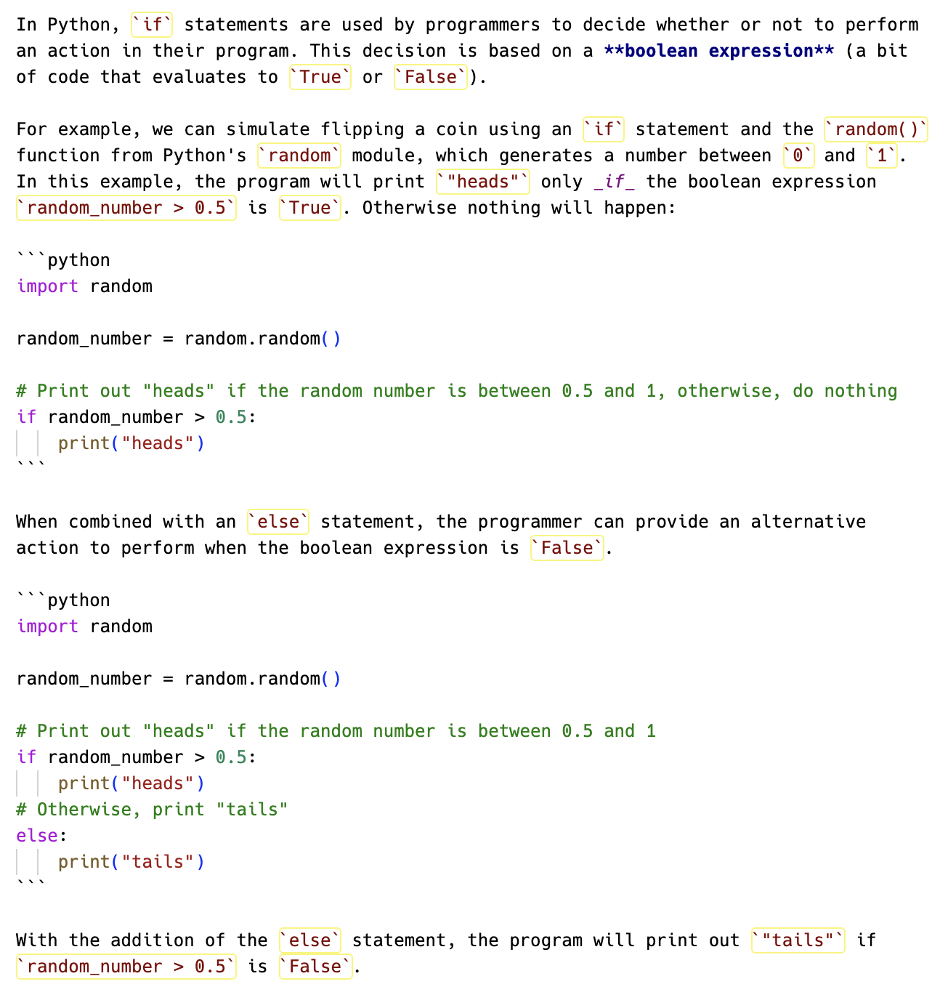

# Short Response Assignments Guide

**Table of Contents:**

- [What is a Short Response Assignment?](#what-is-a-short-response-assignment)
  - [Where to Write Your Responses](#where-to-write-your-responses)
- [Scoring on Short Response Assignments](#scoring-on-short-response-assignments)
  - [Technical Score](#technical-score)
  - [Writing Quality Score](#writing-quality-score)
- [Feedback on Short Response Assignments](#feedback-on-short-response-assignments)
- [Examples of Short Responses](#examples-of-short-responses)
  - [A Response That Could Use Improvement](#a-response-that-could-use-improvement)
  - [An Exemplar Response](#an-exemplar-response)
- [Using AI on Short Response Assignments](#using-ai-on-short-response-assignments)

## What is a Short Response Assignment?

Short Response assignments are opportunities to develop your technical communication skills.

In these assignments, you may encounter the following types of prompts:

- Research a new topic and share your findings.
- Analyze a programming best practice and list its advantages and disadvantages.
- Compare and contrast approaches for solving a problem and provide an argument in support of one.
- Teach a piece of syntax or a concept with examples and analogies.

Unless the prompt names a different audience, your intended audience should be someone with _some_ experience programming but who is still learning. As such, strive to be as clear and concise as possible. There is a fine balance between too much information and just enough but when in doubt, provide more details. Examples and analogies can often help!

Strive to do more than just answer the prompts. Use the prompts as opportunities to practice your technical communication. While anyone can write functional code, not everyone can communicate clearly so take pride in this work!

To set up, submit, and resubmit a short response assignment, follow the steps in [How to Work on Assignments](working-with-assignments.md). This guide covers everything that is specific to short response assignments.

### Where to Write Your Responses

Short Response prompts will always be found in the `short_response.md` file of your assignment. Each question has a `## Question X` heading with its prompt beneath a `### Prompt X` heading, and you should add your response under the `### Response X` heading using Markdown ([read about Markdown syntax here](./how-to-write-markdown.md)). Before you submit, preview your markdown in VS Code (Command/Control + Shift + V) to check how it renders.

For example:



```md
## Question 2

### Prompt 2

Modules let us split up our code into separate files. What are benefits of doing this? Are there any downsides? In your response, use the terms **module** and **import** correctly.

### Response 2

Response here...
```



## Scoring on Short Response Assignments

Your short response work is graded in two categories:

- **Technical Score:** Each of your responses is scored out of 3 points for the technical accuracy and precision of its content.
- **Writing Quality Score:** Your entire submission is scored once, out of 3 points, for whether it was proofread and whether your sentences say what you meant.

For example, an assignment with 4 questions is worth 15 points: 3 technical points for each of the 4 questions, plus 3 writing quality points for the whole submission.

### Technical Score

Each response earns up to 3 points for technical accuracy. Your grader reads every response with four questions in mind:

- **Does it answer every part of the prompt?** Many prompts ask for several things at once, such as a definition, an example, and an explanation of that example. Each part counts on its own. When a prompt asks _why_ or _how_, the answer explains the mechanism, not only the result. When a prompt asks for an example, the example has to be correct and has to run as written.
- **Would a reader who believed every sentence come away with a correct picture?**
- **Is each technical term used correctly?**
- **Does it use every term the prompt asks for?** A prompt that requires technical terms names them, as Prompt 2 above names **module** and **import**. A response that explains an idea correctly but never uses the term the prompt names has one thing to fix.

Each "no" is one thing to fix, and the score counts them. Two missing parts of the prompt count as two things to fix, and a single sentence counts twice if it both says something misleading and misuses a term.

| Score              | Criteria                                                                                                                                    |
| ------------------ | ------------------------------------------------------------------------------------------------------------------------------------------- |
| **3 - Exemplary**  | Nothing to fix.                                                                                                                             |
| **2 - Proficient** | One thing to fix.                                                                                                                           |
| **1 - Developing** | Two or three things to fix.                                                                                                                 |
| **0 - Incomplete** | Four or more things to fix, a response that does not answer the question, or a response that misunderstands the main concept of the prompt. |

Your response is scored only on what its prompt asks for. If a prompt does not ask for an example, a response without one loses nothing.

Going further is welcome but never required. A correct answer that leaves out extra context still earns full marks, and your grader may point you toward where to go next. Everything you write is checked for accuracy, including details the prompt didn't ask for, so check those details as carefully as the rest of your answer.

### Writing Quality Score

The Writing Quality Score measures whether your submission was proofread and whether your sentences say what you meant. Accuracy, required terms, and precision belong to the Technical Score.

Your whole submission is scored once, by checking whether each of these two areas has a problem:

- **Proofreading.** A slip you would fix on sight once someone pointed it out: a misspelled word, a missing or duplicated word, a wrong word form ("possibly" where "possible" belongs), a sentence fragment with no subject or verb of its own, an unclosed backtick, a missing code fence that breaks how code renders, a code fence labelled with the wrong language (such as ` ```javascript ` around Python code), or an escaped character that breaks rendering. This area has a problem when these slips appear in more than one answer, or more than twice within a single answer.
- **Clarity.** At least one sentence that contradicts another statement in your submission, or whose meaning is still wrong after its grammar is repaired. Your grader quotes that sentence in your feedback, so you can see exactly which one it is.

| Score              | Criteria                                                  |
| ------------------ | --------------------------------------------------------- |
| **3 - Exemplary**  | No problems in either area.                               |
| **2 - Proficient** | Problems in one area (proofreading or clarity, not both). |
| **1 - Developing** | Problems in both areas.                                   |
| **0 - Incomplete** | The submission cannot be understood as written.           |

Three rules decide how mistakes are counted:

- **Each mistake counts in one area only.** If fixing the words fixes the meaning, the mistake is proofreading. If the sentence is still wrong after the words are fixed, the mistake is clarity.
- **The number of slips within an area does not change the score.** A dozen typos and three typos both count as one problem in the proofreading area. A second point comes off only when the clarity area has a problem as well.
- **Some writing issues are feedback, never deductions:** a run-on sentence, a comma splice, a long-winded explanation, weak organization or flow, and markdown that renders correctly but is not used effectively. Your grader may mention them to help you improve, but they do not change your score. If a mistake is not on the proofreading list, and the meaning is still right once the grammar is repaired, it is feedback.


In order for a short response assignment to be marked as "Complete", you must score at least a 75% on the assignment.

For example, an assignment with 5 short response prompts has a total possible score of 18 (15 technical points and 3 writing quality points). You must score at least a 14 on that assignment.

Assignments below 75% must be revised and [resubmitted](working-with-assignments.md#resubmitting-an-assignment).


## Feedback on Short Response Assignments

Only the Technical Score and the Writing Quality Score above change your score. To support you in your growth as a technical communicator, your instructor may also provide feedback on the following areas:

**<details><summary>Readability</summary>**

- Is the main idea or goal of the writing clear?
- Are technical terms defined or explained for the intended audience?
- Is the writing free of unnecessary jargon or overly complex language?

</details>

**<details><summary>Structure</summary>**

- Does the content follow a logical flow?
- Are headings, subheadings, and paragraphs effectively used to guide the reader?
- Are transitions between paragraphs / sections smooth and easy to follow?

</details>

**<details><summary>Engagement</summary>**

- Is the tone appropriate for the audience (e.g., conversational vs. formal)?
- Does the writing capture and maintain interest?
- Are examples, analogies and visuals used effectively to enhance understanding?

</details>

**<details><summary>Audience Fit</summary>**

- Does the writing match the knowledge level of the intended audience?
- Are key questions or concerns the audience might have addressed?

</details>

**<details><summary>Formatting</summary>**

- Is the formatting consistent and professional (e.g., indentation in code snippets, use of backticks and code fences to highlight code, use of bolding and italics to emphasize key words)?

</details>

## Examples of Short Responses

Let's look at an example of two responses that are complete and accurate but in very different ways.

The examples below each respond to the following prompt:

> Explain what `if` and `else` statements are used for. Provide a code example to enhance your response.

### A Response That Could Use Improvement

First, let's look at an example of a response that is technically accurate and complete but would likely receive feedback for improvements. As you read, what feedback would you provide?

> 

**<details><summary>See how this response is rendered in Markdown!</summary>**

They are used if you want to like do one thing or another in your code. Here is an example.

if True:
print('this')
else:
print('that')

</details>

For this response, the following feedback would be provided:

- **Readability**: Without the prompt, it would be hard to know that "they" is referring to `if` and `else` statements at the beginning of the sentence. Additionally, no explanation of the example is provided, leaving open the possibility that the reader misunderstands the syntax.
- **Engagement**: The example demonstrates the syntax but the example is hard to relate to a real-world scenario for programming.
- **Formatting**: By adding in markdown formatting, key terms could be highlighted and the provided code block can be placed inside of a code fence (see below for an example of this). Look at the rendered markdown above to see how the line breaks and indentation of the code are lost without a code fence. Python uses indentation to know which lines belong to the `if` and which belong to the `else`, so the rendered code is no longer valid Python.

This response would still earn all 3 Technical points, because it answers both parts of the prompt and its code is correct as written in the file. The missing code fence breaks how the code renders, which makes it a proofreading slip under Writing Quality. One slip in a single answer stays under the proofreading limit, so the feedback above shows the writer how to improve without changing their score.

### An Exemplar Response

Below is a great example of a short response answer. As you read, what do you notice about it?



**<details><summary>See how this response is rendered in Markdown!</summary>**

In Python, `if` statements are used by programmers to decide whether or not to perform an action in their program. This decision is based on a **boolean expression** (a bit of code that evaluates to `True` or `False`).

For example, we can simulate flipping a coin using an `if` statement and the `random()` function from Python's `random` module, which generates a number between `0` and `1`. In this example, the program will print `"heads"` only _if_ the boolean expression `random_number > 0.5` is `True`. Otherwise nothing will happen:

```python
import random

random_number = random.random()

# Print out "heads" if the random number is between 0.5 and 1, otherwise, do nothing
if random_number > 0.5:
    print("heads")
```

When combined with an `else` statement, the programmer can provide an alternative action to perform when the boolean expression is `False`.

```python
import random

random_number = random.random()

# Print out "heads" if the random number is between 0.5 and 1
if random_number > 0.5:
    print("heads")
# Otherwise, print "tails"
else:
    print("tails")
```

With the addition of the `else` statement, the program will print out `"tails"` if `random_number > 0.5` is `False`.

</details>

Among other things, this response does the following things well:

- It answers all parts of the prompt, the information provided is accurate, and the provided code is functional.
- The writing is easy to understand and information is presented in a logical order.
- The provided Python example is engaging as it is highly relatable and demonstrates a practical use case of `if` and `else` statements.
- The example is explained afterwards.
- It uses markdown formatting to bold key terms and highlight code with backticks (e.g. `random.random()`) and wraps the code blocks in code fences. Look at the rendered markdown above to see how the use of markdown dramatically improves the appearance of the writing.

## Using AI on Short Response Assignments

Your short responses are your own words. The [AI Policy](../guidelines-and-policies/ai-policy.md#where-ai-is-never-permitted) does not permit AI to draft or rewrite any part of a short response, in any mode. You may use AI in two ways:

- **Before you write**, as a tutor that quizzes you until you can explain each term out loud without notes.
- **After you write**, to check the grammar and spelling of writing you have already done.

Paste this at the start of a chat if you want the first kind of help, replacing the bracketed text with the assignment's topic:

> You are acting as a tutor. Quiz me on [the topic of this assignment] until I can define each term without looking anything up. Tell me when my reasoning is wrong or imprecise. Do not write or rewrite any part of my response for me.

A response you did not write is worth nothing to you in an interview, which is where this writing is really aimed.
