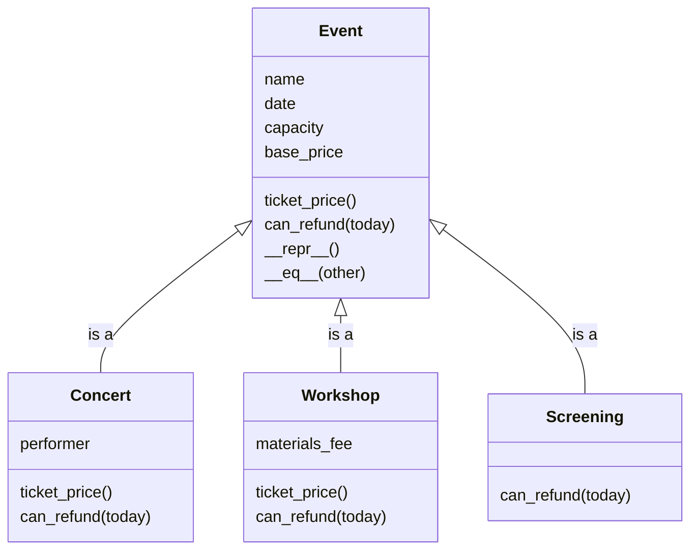

# 2.4 Inheritance and Attribute Lookup

**Table of Contents**

- [Key Terms](#key-terms)
- [Three Kinds of Event](#three-kinds-of-event)
- [Defining a Subclass](#defining-a-subclass)
  - [Adding to a Subclass with `super().__init__()`](#adding-to-a-subclass-with-super__init__)
  - [Overriding a Method](#overriding-a-method)
  - [Extending a Method with `super()`](#extending-a-method-with-super)
  - [Challenge: A Workshop](#challenge-a-workshop)
- [Class Attributes](#class-attributes)
  - [Attribute Lookup](#attribute-lookup)
- [Inheritance or Composition?](#inheritance-or-composition)
- [Testing Each Kind of Event](#testing-each-kind-of-event)
- [Advanced Topics](#advanced-topics)
  - [Forgetting `super().__init__()`](#forgetting-super__init__)
  - [Assigning a Class Attribute Through an Instance](#assigning-a-class-attribute-through-an-instance)
  - [`isinstance()` and `type()`](#isinstance-and-type)
  - [`__mro__`: The Lookup Order Written Down](#__mro__-the-lookup-order-written-down)
  - [Not Every Object Has a `__dict__`](#not-every-object-has-a-__dict__)
- [Summary](#summary)

## Key Terms

- **Inheritance** is a relationship between two classes, where a subclass receives the attributes and methods of a superclass and can add to them.
  - A **superclass**, also called a **parent class**, is the class being inherited from.
  - A **subclass**, also called a **child class**, is the class doing the inheriting: `class Concert(Event):`.
  - **`super()`** reaches the superclass from inside a subclass. `super().__init__(...)` runs the parent's setup, and `super().method()` runs the parent's version of a method you are overriding.
  - **Overriding** is defining a method in a subclass that already exists on the superclass. The subclass's version is the one that runs.
- A **class attribute** is defined in the class body rather than in `__init__`, and every instance shares the one copy. A service fee added to every concert ticket lives here: `Concert.SERVICE_FEE`.
- **Attribute lookup** is the order Python searches when code reads an attribute or calls a method: the instance first, then its class, then the superclass, and onward to `object`. Python uses the first match it finds, which is why a subclass's override runs instead of the parent's version.
  - **`obj.__dict__`** holds the attributes stored on one object. Comparing an instance's `__dict__` with its class's `__dict__` shows which step of attribute lookup finds a name.
  - **`object`** is the class every Python class inherits from, and it is the last place attribute lookup searches.

## Three Kinds of Event

The venue hosts three kinds of event: concerts, workshops, and movie screenings. They are alike in most ways. Every event has a name, a date, a capacity, and a base price. Every event prints as its kind, its name, and its date, and two events with the same name and date are the same event. They differ in only a few ways:

| Kind      | Ticket price                         | Refunds                            |
| --------- | ------------------------------------ | ---------------------------------- |
| Concert   | The base price plus a $5 service fee | Until one week before the show     |
| Workshop  | The base price plus a materials fee  | Until two days before the workshop |
| Screening | The base price                       | Never                              |

Here are the first two written as separate classes, using only what you have learned so far:

```python
from datetime import date, timedelta

class Concert:
    def __init__(self, name, date, capacity, base_price, performer):
        self.name = name
        self.date = date
        self.capacity = capacity
        self.base_price = base_price
        self.performer = performer

    def ticket_price(self):
        return self.base_price + 5

    def can_refund(self, today):
        return today <= self.date - timedelta(days=7)

    def __repr__(self):
        return f'Concert({self.name!r}, {self.date})'

    def __eq__(self, other):
        return self.name == other.name and self.date == other.date


class Workshop:
    def __init__(self, name, date, capacity, base_price, materials_fee):
        self.name = name
        self.date = date
        self.capacity = capacity
        self.base_price = base_price
        self.materials_fee = materials_fee

    def ticket_price(self):
        return self.base_price + self.materials_fee

    def can_refund(self, today):
        return today <= self.date - timedelta(days=2)

    def __repr__(self):
        return f'Workshop({self.name!r}, {self.date})'

    def __eq__(self, other):
        return self.name == other.name and self.date == other.date


jazz = Concert('Friday Night Jazz', date(2026, 12, 5), 40, 25, 'The Blue Notes')
pottery = Workshop('Intro to Pottery', date(2026, 12, 9), 12, 15, 10)

print(jazz.ticket_price())      # 30
print(pottery.ticket_price())   # 25
```

`timedelta(days=7)` is a length of time from the `datetime` module, and subtracting it from a date gives the date one week earlier. So `self.date - timedelta(days=7)` is the last day a concert ticket can be refunded.

**<details><summary>Q: Which lines are the same in both classes, and which are different?</summary>**

The same in both:

- The first four lines of `__init__`, which store the name, the date, the capacity, and the base price.
- `__eq__`, word for word.
- `__repr__`, apart from the class name at the start of the string.

Different:

- The last attribute: a concert stores a `performer`, and a workshop stores a `materials_fee`.
- `ticket_price()`, which adds a different amount to the base price.
- `can_refund()`, which closes refunds a different number of days before the event.

</details>

Every line in the first group is written twice, and a `Screening` class would write it a third time. That repetition costs more than typing:

- Any change to what every event shares has to be made in every copy, and nothing warns you when a copy is missed.
- An event also needs a rule that refuses a capacity below 1, written as a property with a setter. Each kind of event would need its own copy of that property, and a kind of event whose copy was left out would accept a capacity of `0` and sell seats that do not exist.

A concert, a workshop, and a screening are each a kind of event, and Python lets a program say so directly while avoiding the issues above. **Inheritance** lets the shared code live in one class, `Event`, and lets each kind of event be a class that receives everything `Event` has and writes only what is different about it. The rest of this chapter builds that `Event` class and its three kinds.

## Defining a Subclass

**The Problem:** The shared lines in `Concert` and `Workshop` need to live in one place, and each kind of event still needs to be its own class.

**New Concepts:**

- `Event` holds everything every event shares:
  - the four attributes `name`, `date`, `capacity`, and `base_price`
  - the default `ticket_price()` and `can_refund()`
  - `__repr__`, and `__eq__`.
- `class Screening(Event):` makes `Screening` a **subclass** of `Event`. The class in parentheses is the **superclass** (`Event`).
- A subclass with nothing in its body receives every method of its superclass, including `__init__`, so `Screening(...)` takes the same four arguments `Event(...)` does.
- An instance of a subclass is also an instance of its superclass, which `isinstance()` confirms.
- `type(self).__name__` in `Event.__repr__` gives the name of the instance's own class, so a screening prints as `Screening(...)` without having to write its own `__repr__` (subclasses can inherit this shared `__repr__` from their superclass).

**Code:**

```python
class Event:
    def __init__(self, name, date, capacity, base_price):
        self.name = name
        self.date = date
        self.capacity = capacity
        self.base_price = base_price

    def ticket_price(self):
        return self.base_price

    def can_refund(self, today):
        return today < self.date

    def __repr__(self):
        return f'{type(self).__name__}({self.name!r}, {self.date})'

    def __eq__(self, other):
        return self.name == other.name and self.date == other.date


class Screening(Event):
    pass


coco = Screening('Movie Night: Coco', date(2026, 12, 18), 30, 8)
print(coco.ticket_price())           # 8
print(isinstance(coco, Screening))   # True
print(isinstance(coco, Event))       # True
```


**Predict, then run.** `Screening` has no `__repr__` of its own, and the one it receives is written inside `Event`. Does `print(coco)` show `Event('Movie Night: Coco', 2026-12-18)` or `Screening('Movie Night: Coco', 2026-12-18)`?

```python
coco = Screening('Movie Night: Coco', date(2026, 12, 18), 30, 8)
print(coco)
```

<details><summary>What actually happens</summary>

```
Screening('Movie Night: Coco', 2026-12-18)
```

- `print(coco)` calls `__repr__`. `Screening` does not define one, so `coco` uses the one it receives from `Event`.
- Inside that method, `self` is `coco`, so `type(self)` is `Screening`, and `type(self).__name__` is `'Screening'`.
- The method is written once, in `Event`, but it names whichever class the instance was made from.

</details>


Here is the design the rest of this chapter builds. Each class has three sections:

1. The name of the class
2. The attributes of the class
3. The methods of the class

Each arrow means "is a", and each subclass lists only what it adds to `Event` or changes about it:



### Adding to a Subclass with `super().__init__()`

**The Problem:** A concert needs a `performer`, but adding `performer` as a parameter to `Event.__init__` would mean that workshops and screenings would also take a performer.

**New Concepts:**

- A subclass can define its own `__init__`, which replaces the one it would have received from `Event`.
- **`super()`** reaches the superclass from inside a subclass. `super().__init__(name, date, capacity, base_price)` runs `Event`'s `__init__` on the new instance, so the four shared attributes `name`, `date`, `capacity`, and `base_price` are stored by the one piece of code that stores them for every event.
- The subclass then stores what only it has, with `self.performer = performer`.

**Code:**

```python
class Concert(Event):
    def __init__(self, name, date, capacity, base_price, performer):
        super().__init__(name, date, capacity, base_price)
        self.performer = performer


jazz = Concert('Friday Night Jazz', date(2026, 12, 5), 40, 25, 'The Blue Notes')
print(jazz.name)        # Friday Night Jazz, stored by Event's __init__
print(jazz.performer)   # The Blue Notes, stored by Concert's __init__
```


**Predict, then run.** A concert ticket should cost its base price plus a $5 service fee. Based on how `Concert` is currently written, what does `jazz` charge for a ticket?

```python
jazz = Concert('Friday Night Jazz', date(2026, 12, 5), 40, 25, 'The Blue Notes')
print(jazz.ticket_price())
```

<details><summary>What actually happens</summary>

```
25
```

- `Concert` does not define `ticket_price()`, so `jazz` uses the one it receives from `Event`.
- `Event.ticket_price()` returns the base price, `25`, and nothing adds the service fee.

The concert undercharges by $5. The next two sections give `Concert` a `ticket_price()` of its own.

</details>


### Overriding a Method

**The Problem:** Screening tickets are never refunded, but a `Screening` receives `Event`'s `can_refund()`, which allows a refund on any day before the event.

**New Concepts:**

- Defining a method in a subclass with the same name as one in the superclass is called **overriding**. The subclass's version runs for instances of the subclass.
- The superclass's version is unchanged, and it still runs for every event that is not a `Screening`.

**Code:**

```python
class Screening(Event):
    def can_refund(self, today):
        return False


coco = Screening('Movie Night: Coco', date(2026, 12, 18), 30, 8)
board_games = Event('Board Game Night', date(2026, 12, 18), 25, 5)

print(coco.can_refund(date(2026, 12, 1)))          # False, from Screening's version
print(board_games.can_refund(date(2026, 12, 1)))   # True, from Event's version
```


**Check for understanding.** Suppose `Screening`'s method had been misspelled when it was written:

```python
class Screening(Event):
    def can_refunds(self, today):
        return False
```

What does `coco.can_refund(date(2026, 12, 1))` return now, and why? What does that tell you about how an override has to be written?

<details><summary>Answer</summary>

It returns `True`.

- `can_refunds` is a new method with a different name, so it does not override anything.
- `coco.can_refund(...)` asks for `can_refund`, which `Screening` no longer defines, so `coco` uses the one it receives from `Event`.
- `Event.can_refund()` allows a refund on any day before the event, and December 1 comes before December 18.

An override has to use exactly the same name as the superclass's method. Python gives no warning when the name is wrong, so the subclass keeps the parent's behavior without anyone noticing: here, a screening ticket that should never be refunded can be.

</details>


### Extending a Method with `super()`

**The Problem:** A concert's ticket price is the base price plus the service fee. Writing `return self.base_price + 5` in `Concert` repeats `Event`'s rule for the base price, so if the venue later changes how every event's base price is worked out, such as a member discount, concerts would keep the old rule.

**New Concepts:**

- `super().ticket_price()` runs `Event`'s version of the method on the same instance and hands back its result, the base price.
- The override then adds only what is different about a concert: the $5 service fee.
- An override without `super()` replaces the parent's version entirely. Calling `super()` inside the override extends the parent's version instead.

**Code:**

```python
class Concert(Event):
    def __init__(self, name, date, capacity, base_price, performer):
        super().__init__(name, date, capacity, base_price)
        self.performer = performer

    def ticket_price(self):
        return super().ticket_price() + 5

    def can_refund(self, today):
        return today <= self.date - timedelta(days=7)


jazz = Concert('Friday Night Jazz', date(2026, 12, 5), 40, 25, 'The Blue Notes')
print(jazz.ticket_price())                     # 30: Event's 25, plus Concert's 5
print(jazz.can_refund(date(2026, 11, 30)))     # False: refunds closed on November 28
```

### Challenge: A Workshop

Write `Workshop` as a subclass of `Event`. Its `__init__` takes a fifth argument, `materials_fee`, and stores it. Its `ticket_price()` extends `Event`'s version by adding the materials fee, and its `can_refund()` allows a refund until two days before the workshop.

```python
pottery = Workshop('Intro to Pottery', date(2026, 12, 9), 12, 15, 10)
print(pottery)                                # Workshop('Intro to Pottery', 2026-12-09)
print(pottery.ticket_price())                 # 25
print(pottery.can_refund(date(2026, 12, 7)))  # True
print(pottery.can_refund(date(2026, 12, 8)))  # False
```

**<details><summary>Solution</summary>**

```python
class Workshop(Event):
    def __init__(self, name, date, capacity, base_price, materials_fee):
        super().__init__(name, date, capacity, base_price)
        self.materials_fee = materials_fee

    def ticket_price(self):
        return super().ticket_price() + self.materials_fee

    def can_refund(self, today):
        return today <= self.date - timedelta(days=2)
```

- `super().__init__(...)` stores the four shared attributes, so `Workshop.__init__` only has to store `materials_fee`.
- `super().ticket_price()` returns the base price, `15`, and the override adds the materials fee, `10`.
- `can_refund()` replaces `Event`'s version without calling `super()`, because the two-day rule does not build on the event's rule.
- `Workshop` writes no `__repr__` and still prints as `Workshop(...)`, because `Event.__repr__` uses `type(self).__name__`.

</details>


**Check for understanding.** Open `src/events.py` in the case study. For each of `Concert`, `Workshop`, and `Screening`, list which of `__init__`, `ticket_price()`, and `can_refund()` the class defines itself and which it receives from `Event`. Then say which of its methods use `super()` to extend `Event`'s version rather than replace it.

<details><summary>Answer</summary>

- **`Concert`** defines all three. `__init__` and `ticket_price()` call `super()` to extend `Event`'s versions, and `can_refund()` replaces `Event`'s version with the one-week rule.
- **`Workshop`** defines all three in the same way: `__init__` and `ticket_price()` extend `Event`'s versions with `super()`, and `can_refund()` replaces `Event`'s version with the two-day rule.
- **`Screening`** defines only `can_refund()`, which replaces `Event`'s version and returns `False`. It receives `__init__` and `ticket_price()` from `Event` unchanged, which the comment at the top of the class points out.

</details>


## Class Attributes

**The Problem:** Every concert adds the same $5 service fee, but `Concert.ticket_price()` writes it as a bare `5` without a variable naming why `5` is being added. Additionally, any other code that needs the fee amount, such as a receipt that lists the fee on its own line, has to write `5` again.

**A Solution with Another Problem**: Storing the fee on each concert in `__init__`, with `self.service_fee = 5`, gives the fee a name but gives every concert its own copy. When the venue raises the fee to $6, every concert that already exists still holds `5`, and the venue charges two different fees for the same kind of ticket. Or, every existing concert needs to have its `service_fee` updated individually.

**New Concepts:**

- The fee is information about concerts in general, not about one concert, so it belongs to the class.
- A **class attribute** is assigned in the class body, outside any method. There is only one copy of it, and that copy belongs to the class.
- `Concert.SERVICE_FEE` reads the class attribute through the class's name, the same way the case study's `Concert` class does.
- The name is written in capital letters because the fee is a **constant**: a value the program reads but does not change while it runs. Capitals tell a reader at a glance that nothing should be assigned to it.

**Code:**

```python
class Concert(Event):
    SERVICE_FEE = 5

    def __init__(self, name, date, capacity, base_price, performer):
        super().__init__(name, date, capacity, base_price)
        self.performer = performer

    def ticket_price(self):
        return super().ticket_price() + Concert.SERVICE_FEE

    # ... can_refund() from above ...


jazz = Concert('Friday Night Jazz', date(2026, 12, 5), 40, 25, 'The Blue Notes')
print(jazz.ticket_price())   # 30
```


**Predict, then run.** The venue raises the service fee for every concert, including the two already scheduled. What do the last two lines print?

```python
jazz = Concert('Friday Night Jazz', date(2026, 12, 5), 40, 25, 'The Blue Notes')
choir = Concert('Winter Choir', date(2026, 12, 19), 80, 10, 'Riverside Singers')

Concert.SERVICE_FEE = 6

print(jazz.ticket_price())
print(choir.ticket_price())
```

<details><summary>What actually happens</summary>

```
31
16
```

Both concerts read `Concert.SERVICE_FEE` when `ticket_price()` runs, and there is only one `Concert.SERVICE_FEE`. Changing it once changes the fee for every concert, including ones created before the change.

</details>


### Attribute Lookup

**The Problem:** The attributes that can be accessed through a `Concert` instance like `jazz` are stored in different places:

- `name` is stored on the instance
- `ticket_price()` is defined on both `Concert` and `Event`
- `__repr__()` is defined on `Event` but not on `Concert`

The program needs a rule that says where to look for a name the instance does not hold, and which version of a method runs when two classes both define it, as `Concert` and `Event` both define `ticket_price()`.

**New Concepts:**

- When code reads `jazz.something`, Python searches in a fixed order, called **attribute lookup**: the instance → then its class → then the superclass → then `object`. It uses the first match it finds and stops searching.
- That order is why an override wins: Python finds `ticket_price` on `Concert` before it reaches `Event`.
- It is also how an instance reads a class attribute: `jazz.SERVICE_FEE` finds nothing on the instance and finds the fee on `Concert`. Code outside the class reads a class attribute through the class, as `Concert.SERVICE_FEE`, so that a reader can see at a glance that the value is shared.
- **`obj.__dict__`** shows what one place holds. Comparing the instance's `__dict__` with each class's `__dict__` shows which step of the search finds a name.
- **`object`** is the class every class inherits from. It supplies methods nobody wrote, such as `__ne__`, which is why `!=` works on events even though `Event` only defines `__eq__`.
- `dir()` lists every name the search can reach, from every step. `__dict__` lists only what one place holds.
- If no step has the name, Python raises `AttributeError`.

**Code:**

```python
jazz = Concert('Friday Night Jazz', date(2026, 12, 5), 40, 25, 'The Blue Notes')

print(jazz.__dict__)
# {'name': 'Friday Night Jazz', 'date': datetime.date(2026, 12, 5), 'capacity': 40, 'base_price': 25, 'performer': 'The Blue Notes'}

print('SERVICE_FEE' in jazz.__dict__)       # False
print('SERVICE_FEE' in Concert.__dict__)    # True: found one step up, on the class
print('ticket_price' in Concert.__dict__)   # True: found on Concert, so Event's version is never reached
print('__repr__' in Concert.__dict__)       # False
print('__repr__' in Event.__dict__)         # True: found one step further up
print('__ne__' in Event.__dict__)           # False
print('__ne__' in object.__dict__)          # True: found at the last step

jazz.blah
# AttributeError: 'Concert' object has no attribute 'blah'
```

Every name read through `jazz` is searched for in this order, and the search stops at the first place that has it:


**<details><summary>Q: A list `[]` holds its items, but where does a list's `append()` method live?</summary>**

On the `list` class, not on each list instance:

```python
seats = ['A1', 'A2']
print('append' in dir(seats))      # True: seats can use append()
print('append' in list.__dict__)   # True: the list class stores it

seats.label = 'balcony'
# AttributeError: 'list' object has no attribute 'label'
# `seats` has no __dict__ for setting new attributes
```

`dir(seats)` shows that `seats` can use `append()`, and `list.__dict__` shows that the `list` class stores it. A list cannot store attributes of its own at all, so `append()` can only come from the class, the same way `jazz` finds `ticket_price()` on `Concert`. One copy of the method serves every list.

This is true of instances of built-in data types such as lists, strings, integers, and dictionaries: they have no `__dict__` of their own, so they cannot store attributes. Instances of the classes you write do have a `__dict__`, which is why `jazz` can store its `name` and its `performer`.

</details>


**Check for understanding.** `jazz` is a `Concert`, made from the class in the [Class Attributes section](#class-attributes). The `Concert` class defines `SERVICE_FEE`, `__init__`, `ticket_price()`, and `can_refund()`. For each expression below, name the places Python searches, in order, and the place where the search stops.

1. `jazz.performer`
2. `jazz.ticket_price()`
3. `jazz.__repr__()`
4. `jazz.__ne__(coco)`
5. `jazz.blah`

<details><summary>Answers</summary>

1. **The instance.** `Concert.__init__` stored `performer` on `jazz`, so the search stops at the first step.
2. **The instance, then `Concert`.** `jazz` holds no `ticket_price`, and `Concert` defines one, so the search stops at `Concert` and `Event`'s version never runs.
3. **The instance, then `Concert`, then `Event`.** Neither `jazz` nor `Concert` defines `__repr__`, and `Event` does.
4. **The instance, then `Concert`, then `Event`, then `object`.** Nobody wrote `__ne__`, and `object` supplies it.
5. **The instance, then `Concert`, then `Event`, then `object`.** No step has `blah`, so Python raises `AttributeError: 'Concert' object has no attribute 'blah'`.

</details>



**Check for understanding.** Open `src/events.py` in the case study and find `SERVICE_FEE`. Is the fee stored on each concert, on `Concert`, or on `Event`? Name the places attribute lookup searches for `jazz.SERVICE_FEE`, where `jazz` is a concert, and say where it stops. Then predict what `pottery.SERVICE_FEE` does, where `pottery` is a workshop.

<details><summary>Answer</summary>

- `SERVICE_FEE = 5` is written in the body of `Concert`, so it is stored once, on the `Concert` class.
- For `jazz.SERVICE_FEE`, Python searches the instance first. `__init__` never stored a fee on `jazz`, so the search moves on to `Concert`, finds `5`, and stops.
- For `pottery.SERVICE_FEE`, Python searches the instance, then `Workshop`, then `Event`, then `object`. `Concert` is not on a workshop's search path, so no step has `SERVICE_FEE`, and Python raises `AttributeError: 'Workshop' object has no attribute 'SERVICE_FEE'`.

</details>


## Inheritance or Composition?

**The Problem:** A program now has two ways to connect classes: one class can inherit from another, or one object can hold another. So, how do we choose?

**New Concepts:**

- **"Is a"** describes **inheritance**: a concert is an event and shares many of the same attributes as an event, so `Concert` inherits from `Event`.
- **"Has a"** describes **composition**: a reservation has an attendee and an event but has different attributes from both, so `Reservation` holds them as attributes. We might say that "a reservation is composed of an attendee and the event they are attending"
- Two proposed subclasses that differ only in the value of one attribute should usually be one class with that attribute. A `MatineeScreening` and an `EveningScreening` that differ only in their start time are one `Screening` class with a `start_time` attribute.

**Code:**

```python
class Concert(Event):          # a concert is an event
    ...

@dataclass
class Reservation:             # a reservation has an attendee and an event
    attendee: Attendee
    event: Event
```


**Check for understanding.** A restaurant is designing its ordering system. For each pair of classes, decide whether the relationship is "is a" (inheritance), "has a" (composition), or "one class with an attribute", and give a one-sentence reason.

1. `BreakfastItem` and `MenuItem`
2. `Restaurant` and `MenuItem`
3. `Order` and `Customer`
4. `Chef` and `Employee`
5. `SmallCoffee` and `LargeCoffee`

<details><summary>Answers</summary>

1. **Is a.** A breakfast is a kind of menu item, with the same name, description, and price, so `BreakfastItem` inherits from `MenuItem` and adds only its available hours.
2. **Has a.** A restaurant holds many menu items, but a restaurant is not a menu item: it has no price, so `Restaurant` keeps its menu items in a list attribute.
3. **Has a.** An order belongs to a customer, but an order is not a person, so `Order` holds a `Customer` as an attribute.
4. **Is a.** A chef is a kind of employee, with the same name and hourly wage, so `Chef` inherits from `Employee` and adds only its specialty.
5. **One class with an attribute.** The two classes would differ only in one value, so one `Coffee` class with a `size` attribute covers both, and a new size needs no new class.

</details>



**Check for understanding.** Open `DESIGN.md` in the case study and read section 4, Relationships. Which relationships are inheritance, and which are composition? For each composition, name the class that holds the other.

<details><summary>Answer</summary>

- **Inheritance:** `Concert`, `Workshop`, and `Screening` each inherit from `Event`, because each one is an event.
- **Composition:**
  - `Venue` holds three collections: its events, its attendees, and its reservations.
  - `Reservation` holds one `Attendee` and one `Event`.

</details>


## Testing Each Kind of Event

**The Problem:** Each subclass can override a method and break it on its own. A test of `Event.ticket_price()` passes even when `Workshop.ticket_price()` has stopped adding the materials fee.

**New Concepts:**

- Write one test per subclass that makes the same call and asserts the result that subclass should give.
- Use the same base price in every test, so that the difference between the expected results is exactly what each subclass adds.

**Code:**

Set up a project with `Event` and its three subclasses in `src/events.py`, and the tests in `tests/test_events.py`:

```
inheritance-practice/
├── .venv/
├── pytest.ini
├── src/
│   └── events.py
└── tests/
    └── test_events.py
```

`pytest.ini` holds the same two settings as every Mod 2 repository: `pythonpath = src` lets the test file import from the `src` folder, and `testpaths = tests` tells pytest where the tests are:

```
[pytest]
pythonpath = src
testpaths = tests
```

Then write one test per kind of event, each with a base price of `25`:

```python
from datetime import date

from events import Concert, Screening, Workshop


def test_a_concert_adds_the_service_fee():
    jazz = Concert('Friday Night Jazz', date(2026, 12, 5), 40, 25, 'The Blue Notes')
    assert jazz.ticket_price() == 30


def test_a_workshop_adds_the_materials_fee():
    pottery = Workshop('Intro to Pottery', date(2026, 12, 9), 12, 25, 10)
    assert pottery.ticket_price() == 35


def test_a_screening_charges_the_base_price():
    coco = Screening('Movie Night: Coco', date(2026, 12, 18), 30, 25)
    assert coco.ticket_price() == 25
```

With the virtual environment turned on and pytest installed, run `pytest` from the `inheritance-practice` folder. All three tests pass.


**Predict, then run.** In `src/events.py`, change the last line of `Workshop.ticket_price()` from `return super().ticket_price() + self.materials_fee` to `return self.materials_fee`, and run `pytest` again. Which tests fail, and what does pytest report?

<details><summary>What actually happens</summary>

Only the workshop test fails:

```
>       assert pottery.ticket_price() == 35
E       AssertionError: assert 10 == 35
E        +  where 10 = ticket_price()
E        +    where ticket_price = Workshop('Intro to Pottery', 2026-12-09).ticket_price
```

- `Workshop.ticket_price()` no longer calls `super()`, so it returns the materials fee, `10`, without the base price.
- The concert and screening tests still pass, because their classes did not change.
- Each kind of event has its own test, so the failing test's name says which subclass broke.

Change the line back before moving on.

</details>



**Check for understanding.** This test is based on one in the case study's `tests/test_events.py`, with the three events built inside the test. (In the case study's file, the events come from shared setup in `tests/conftest.py`, which the case study session explains.)

```python
def test_each_kind_of_event_prices_its_tickets_differently():
    jazz = Concert('Friday Night Jazz', date(2026, 12, 13), 40, 25, 'The Blue Notes')
    pottery = Workshop('Intro to Pottery', date(2026, 12, 5), 2, 15, 10)
    spirited_away = Screening('Movie Night: Spirited Away', date(2026, 12, 21), 30, 8)

    assert jazz.ticket_price() == 30            # 25 plus the 5 service fee
    assert pottery.ticket_price() == 25         # 15 plus the 10 materials fee
    assert spirited_away.ticket_price() == 8    # the base price, unchanged
```

Name the rule each `assert` protects. Then suppose `Concert.ticket_price()` stopped adding the service fee. What would pytest report, and what would it leave unchecked that three separate tests would have checked?

<details><summary>Answer</summary>

- The first `assert` protects the rule that a concert adds the $5 service fee to its base price.
- The second protects the rule that a workshop adds its materials fee to its base price.
- The third protects the rule that a screening charges its base price, unchanged.

If the concert broke, the first `assert` would fail with `assert 25 == 30`, and pytest would stop that test there. The workshop and screening `assert` lines would never run, so the report would say nothing about whether those two prices still work. Three separate tests would each run, and the report would show that only the concert broke.

</details>


## Advanced Topics

### Forgetting `super().__init__()`

**The Problem:** A subclass `__init__` that never calls `super().__init__()` creates the instance without the shared attributes, and nothing complains until code reads one of them.

**New Concepts:**

- The error appears on the line that reads `jazz.name`, not on the line that left out `super().__init__()`. The mistake and the symptom are in two different places, so whoever investigates starts from the wrong line.

**Code:**

```python
class Concert(Event):
    def __init__(self, name, date, capacity, base_price, performer):
        self.performer = performer      # super().__init__() is missing

jazz = Concert('Friday Night Jazz', date(2026, 12, 5), 40, 25, 'The Blue Notes')
print(jazz.name)
# AttributeError: 'Concert' object has no attribute 'name'
```

### Assigning a Class Attribute Through an Instance

Assigning to a class attribute's name through an instance does not change the class attribute. It creates a new instance attribute with the same name on that one instance:

```python
jazz = Concert('Friday Night Jazz', date(2026, 12, 5), 40, 25, 'The Blue Notes')
jazz.SERVICE_FEE = 0

print(jazz.SERVICE_FEE)      # 0
print(Concert.SERVICE_FEE)   # 5
print(jazz.ticket_price())   # 30
```

`jazz.__dict__` now holds its own `SERVICE_FEE` of `0`, so attribute lookup finds that one first when code reads `jazz.SERVICE_FEE`. But `ticket_price()` reads `Concert.SERVICE_FEE`, so the price is still $30, and a reader who sees `jazz.SERVICE_FEE` print `0` is left believing the fee was waived when it was not. To change a class attribute, assign to it through the class: `Concert.SERVICE_FEE = 6`.

### `isinstance()` and `type()`

**The Problem:** Code that asks whether an object is an event with `type(obj) == Event` gets `False` for every concert, workshop, and screening, so a check written that way turns away every subclass.

**New Concepts:**

- `isinstance(jazz, Event)` is `True`, because a concert is an event.
- `type(jazz) == Event` is `False`, because `type()` names only the instance's own class.
- Use `isinstance()` when asking whether an object is a kind of something.

**Code:**

```python
jazz = Concert('Friday Night Jazz', date(2026, 12, 5), 40, 25, 'The Blue Notes')

print(isinstance(jazz, Concert))   # True
print(isinstance(jazz, Event))     # True
print(type(jazz) == Concert)       # True
print(type(jazz) == Event)         # False
```

### `__mro__`: The Lookup Order Written Down

**The Problem:** When an attribute lookup finds a different method than expected, you need to see the exact order in which Python searches the classes.

**New Concepts:**

- `Concert.__mro__` holds the order Python searches the classes. MRO stands for method resolution order.
- A class can name more than one superclass, which is called **multiple inheritance**, and `__mro__` is how Python orders the search then. Recognize it when you see it, and use single inheritance in your own classes.

**Code:**

```python
print(Concert.__mro__)
# (<class '__main__.Concert'>, <class '__main__.Event'>, <class 'object'>)
```

### Not Every Object Has a `__dict__`

**The Problem:** `__dict__` shows the attributes of an instance of a class you wrote, but using it to explore a built-in value fails.

**New Concepts:**

- Instances of the classes you write keep their attributes in a `__dict__`, but many built-in types do not.
- `dir()` works on every object, so use it to explore a value whose class you did not write.

**Code:**

```python
seats = ['A1', 'A2']

print('append' in dir(seats))   # True
print(seats.__dict__)
# AttributeError: 'list' object has no attribute '__dict__'
```

## Summary

- **Stub:** one paragraph, as in earlier chapters. It covers four things:
  - shared code lives in a superclass, and each subclass writes only what differs;
  - `super().__init__()` runs the parent's setup, and `super().method()` extends the parent's version of a method;
  - a class attribute holds one value every instance shares, such as `Concert.SERVICE_FEE`;
  - attribute lookup searches the instance, its class, the superclass, then `object`, and uses the first match, which is why an override wins;
  - "is a" means inheritance, and "has a" means composition.
