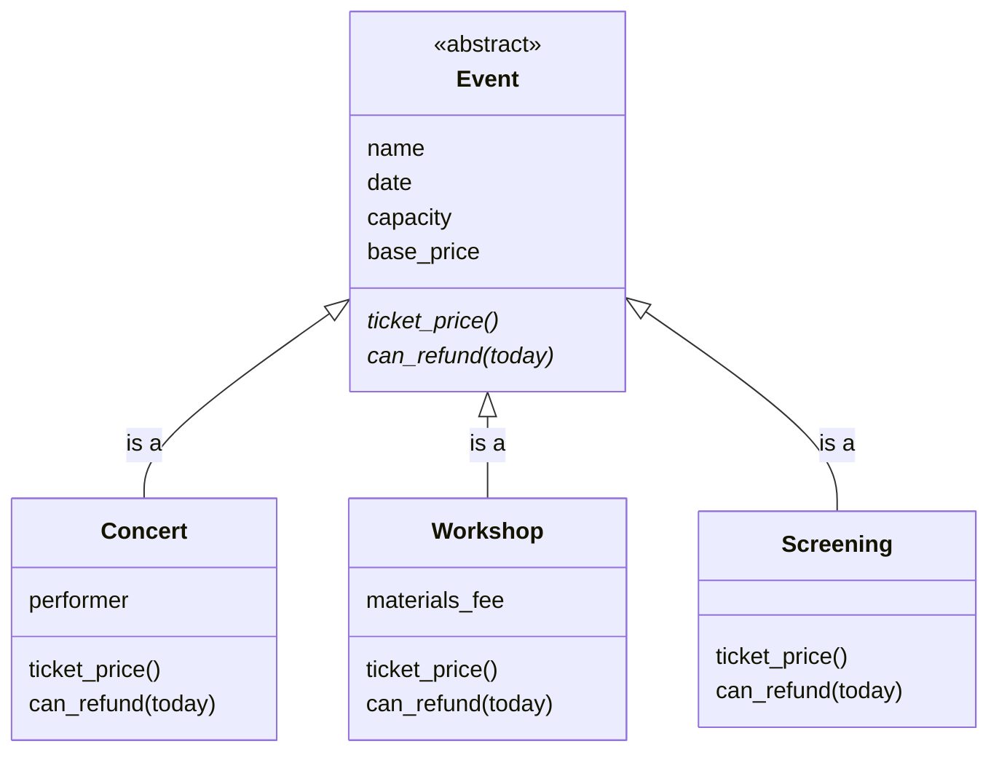

# 2.5 Polymorphism, Duck Typing, and Abstract Base Classes

**Table of Contents**

- [Key Terms](#key-terms)
- [Asking Which Kind of Event](#asking-which-kind-of-event)
- [Letting Each Kind of Event Decide](#letting-each-kind-of-event-decide)
  - [Challenge: A Refund Deadline Without `isinstance()`](#challenge-a-refund-deadline-without-isinstance)
- [Writing Down the Contract](#writing-down-the-contract)
- [Duck Typing](#duck-typing)
- [Abstract Base Classes](#abstract-base-classes)
- [Abstract Base Class or Duck Typing?](#abstract-base-class-or-duck-typing)
- [Testing That an Incomplete Kind of Event Is Refused](#testing-that-an-incomplete-kind-of-event-is-refused)
- [Advanced Topics](#advanced-topics)
  - [`raise NotImplementedError`](#raise-notimplementederror)
- [Summary](#summary)

## Key Terms

- **Polymorphism** is different types of object responding to the same method call in their own way, so that the code making the call does not need to know which type it is holding. `len()` works on a string, a list, and a dictionary, and each type works out its own length.
- A **shared interface**, or **contract**, is the set of method names every type in a group promises to define. It is what makes polymorphism safe.
  - **Duck typing** is writing code that relies on the methods an object defines rather than on the class it came from. A loop that calls `ticket_price()` on every item works with any object that defines `ticket_price()`, whether or not its class inherits from `Event`.
- An **abstract base class (ABC)** is a class that cannot be instantiated and exists to declare the methods its subclasses must provide.
  - **`@abstractmethod`** marks a method a subclass is required to define. A subclass that forgets one raises `TypeError` the moment anything tries to instantiate it, rather than failing later at the call site.
  - A **concrete class** is a class you can actually instantiate, because every abstract method has been defined.

## Asking Which Kind of Event

The venue's menu lists every event with its ticket price. The menu also needs to show which tickets can still be refunded, so it currently displays a `(refundable)` marker beside them:

```text
Friday Night Jazz: $30
Intro to Pottery: $25 (refundable)
Movie Night: Coco: $8
```

Let's look at how the program produces this menu. Here are the venue's three kinds of event, with the rules for their prices and refunds written in two functions outside the classes:

```python
from datetime import date, timedelta


class Event:
    def __init__(self, name, date, capacity, base_price):
        self.name = name
        self.date = date
        self.capacity = capacity
        self.base_price = base_price


# Same as Event with a performer
class Concert(Event):
    def __init__(self, name, date, capacity, base_price, performer):
        super().__init__(name, date, capacity, base_price)
        self.performer = performer


# Same as Event with a materials fee
class Workshop(Event):
    def __init__(self, name, date, capacity, base_price, materials_fee):
        super().__init__(name, date, capacity, base_price)
        self.materials_fee = materials_fee


# Exact same as Event
class Screening(Event):
    pass


# One branch for each kind of event
def ticket_price(event):
    if isinstance(event, Concert):
        return event.base_price + 5
    elif isinstance(event, Workshop):
        return event.base_price + event.materials_fee
    else:
        return event.base_price


# One branch for each kind of event
def can_refund(event, today):
    if isinstance(event, Concert):
        # Can be refunded up to 7 days before
        return today <= event.date - timedelta(days=7)
    elif isinstance(event, Workshop):
        # Can be refunded up to 2 days before
        return today <= event.date - timedelta(days=2)
    else:
        return False


jazz = Concert('Friday Night Jazz', date(2026, 12, 5), 40, 25, 'The Blue Notes')
pottery = Workshop('Intro to Pottery', date(2026, 12, 9), 12, 15, 10)
coco = Screening('Movie Night: Coco', date(2026, 12, 18), 30, 8)

# today is 4 days before the concert, 8 before the workshop
today = date(2026, 12, 1)

for event in [jazz, pottery, coco]:
    price = ticket_price(event)
    marker = ' (refundable)' if can_refund(event, today) else ''
    print(f'{event.name}: ${price}{marker}')

# Friday Night Jazz: $30
# Intro to Pottery: $25 (refundable)
# Movie Night: Coco: $8
```

`can_refund` and `ticket_price` each work by asking which kind of event they have been given, with `isinstance()`, and then branching. The prices and refund answers are correct, but there are a few downsides to this approach:

- The rules for each kind of event live outside the class they belong to.
- Every function that needs a different answer for each kind of event repeats the same `if`/`elif` chain (notice how repetitive the two functions are).
- Adding a kind of event means finding every one of those functions and adding a branch to each. Nothing warns you when one is missed, because the `else` branch catches every kind of event that no branch names.

**<details><summary>Q: The venue adds guided tours. A guided tour charges its base price plus a $3 booking fee, and its tickets can be refunded until the day before. `Tour` is added as a subclass, and nobody edits the two functions. What do the two `print()` calls show?</summary>**

```python
class Tour(Event):
    BOOKING_FEE = 3

harbor = Tour('Harbor History Walk', date(2026, 12, 12), 15, 20)
print(ticket_price(harbor))
print(can_refund(harbor, date(2026, 12, 1)))
```

```
20
False
```

- A tour is neither a `Concert` nor a `Workshop`, so both functions fall through to their `else` branch.
- The `else` branch of `ticket_price()` returns the base price, `20`, without the $3 booking fee.
- The `else` branch of `can_refund()` was written for screenings, so it returns `False`, and a tour that should be refundable eleven days early is refused.

Nothing crashes, so the venue undercharges every tour and turns away every tour refund until someone notices.

</details>

Each kind of event is already a class, so each class can hold its own version of each rule. Then the menu can call `event.ticket_price()` on any event and get the right answer without asking which kind of event it has. Code that calls the same method on different kinds of object, and gets each kind's own answer, is called **polymorphism**. The rest of this chapter builds on it: writing down which methods every kind of event must provide, using objects that share no parent class, and making Python refuse a kind of event that leaves a method out.

## Letting Each Kind of Event Decide

**The Problem:** The `ticket_price()` and `can_refund()` functions ask every event which kind it is, so every new kind of event needs a new branch in every function, and a missed branch gives a wrong answer without an error.

**New Concepts:**

- Each subclass defines its own `ticket_price()` and `can_refund()`, overriding `Event`'s versions, so the rule for each kind of event lives in that kind's class.
- Code that uses an event calls `event.ticket_price()` and never checks the kind. Attribute lookup finds the method on the event's own class, or on `Event` when the subclass does not override it.
- **Polymorphism** is different types of object responding to the same method call in their own way, so that the code making the call does not need to know which type it is holding. The word comes from Greek: _poly_, "many", and _morph_, "form".
- Python's built-in types already work this way: `len()` works on a string, a list, and a dictionary, and each type works out its own length.
- Adding a kind of event now means writing one new class. No code that uses events has to change.

**Code:**

```python
class Event:
    def __init__(self, name, date, capacity, base_price):
        self.name = name
        self.date = date
        self.capacity = capacity
        self.base_price = base_price

    def ticket_price(self):
        return self.base_price

    def can_refund(self, today):
        return today < self.date


class Concert(Event):
    SERVICE_FEE = 5

    def __init__(self, name, date, capacity, base_price, performer):
        super().__init__(name, date, capacity, base_price)
        self.performer = performer

    def ticket_price(self):
        return super().ticket_price() + Concert.SERVICE_FEE

    def can_refund(self, today):
        return today <= self.date - timedelta(days=7)


class Workshop(Event):
    def __init__(self, name, date, capacity, base_price, materials_fee):
        super().__init__(name, date, capacity, base_price)
        self.materials_fee = materials_fee

    def ticket_price(self):
        return super().ticket_price() + self.materials_fee

    def can_refund(self, today):
        return today <= self.date - timedelta(days=2)


class Screening(Event):
    def can_refund(self, today):
        return False


jazz = Concert('Friday Night Jazz', date(2026, 12, 5), 40, 25, 'The Blue Notes')
pottery = Workshop('Intro to Pottery', date(2026, 12, 9), 12, 15, 10)
coco = Screening('Movie Night: Coco', date(2026, 12, 18), 30, 8)
events = [jazz, pottery, coco]

for event in events:
    print(f'{event.name}: ${event.ticket_price()}')
# Friday Night Jazz: $30
# Intro to Pottery: $25
# Movie Night: Coco: $8

print(len('Coco'), len(['A1', 'A2']), len({'jazz': 30}))   # 4 2 1
```


**Predict, then run.** The venue adds guided tours again: the base price plus a $3 booking fee, refundable until the day before. This time `Tour` defines its own `ticket_price()` and receives `Event`'s `can_refund()`. What does the loop print?

```python
class Tour(Event):
    BOOKING_FEE = 3

    def ticket_price(self):
        return super().ticket_price() + Tour.BOOKING_FEE


harbor = Tour('Harbor History Walk', date(2026, 12, 12), 15, 20)
events.append(harbor)

today = date(2026, 12, 1)
for event in events:
    price = event.ticket_price()
    marker = ' (refundable)' if event.can_refund(today) else ''
    print(f'{event.name}: ${price}{marker}')
```

<details><summary>What actually happens</summary>

```
Friday Night Jazz: $30
Intro to Pottery: $25 (refundable)
Movie Night: Coco: $8
Harbor History Walk: $23 (refundable)
```

- The loop is the same for every event. Each call runs the version of the method defined on that event's own class.
- `harbor.ticket_price()` runs `Tour`'s version: `Event`'s base price, `20`, plus the booking fee, `3`.
- `harbor.can_refund(today)` runs `Event`'s version, because `Tour` does not override it, and December 1 comes before December 12.
- Friday Night Jazz is not refundable, because its refunds closed on November 28.

Adding tours took one new class. The loop did not change.

</details>


**<details><summary>Q: How does this example show polymorphism?</summary>**

```python
class Car:
    def __init__(self, make, model):
        self.make = make
        self.model = model

    def drive(self):
        print('Vrooom')


class RaceCar(Car):
    def drive(self):
        print('Vah... Vah...')
        super().drive()
        print('WHEEEEEEE!!!!')


cars = [Car('Chevy', 'Cobalt'), RaceCar('Ferrari', 'Portofino'), Car('Tesla', 'Model X')]
for car in cars:
    car.drive()
# Vrooom
# Vah... Vah...
# Vrooom
# WHEEEEEEE!!!!
# Vrooom
```

`Car` and `RaceCar` both define `drive()`, and each one does something different when it runs. The loop calls `car.drive()` on every car without knowing whether it holds a `Car` or a `RaceCar`, and each car responds in its own way. That is polymorphism: one method call, different behavior for each type, and calling code that never has to ask which type it holds.

</details>

### Challenge: A Refund Deadline Without `isinstance()`

The refund desk prints the last day each ticket can be refunded, using this function:

```python
board_games = Event('Board Game Night', date(2026, 12, 18), 25, 5)


def refund_deadline(event):
    if isinstance(event, Concert):
        return event.date - timedelta(days=7)
    elif isinstance(event, Workshop):
        return event.date - timedelta(days=2)
    elif isinstance(event, Screening):
        return None
    else:
        return event.date - timedelta(days=1)


for event in [jazz, pottery, coco, board_games]:
    print(f'{event.name}: {refund_deadline(event)}')
# Friday Night Jazz: 2026-11-28
# Intro to Pottery: 2026-12-07
# Movie Night: Coco: None
# Board Game Night: 2026-12-17
```

Refactor it so that each kind of event works out its own deadline. Give `Event` and each subclass that needs one a `refund_deadline()` method, delete the function, and change the loop to call `event.refund_deadline()`. The loop must print the same four lines as before.

**<details><summary>Solution</summary>**

```python
class Event:
    # ... __init__, ticket_price(), and can_refund() from above ...

    def refund_deadline(self):
        return self.date - timedelta(days=1)


class Concert(Event):
    # ... __init__, ticket_price(), and can_refund() from above ...

    def refund_deadline(self):
        return self.date - timedelta(days=7)


class Workshop(Event):
    # ... __init__, ticket_price(), and can_refund() from above ...

    def refund_deadline(self):
        return self.date - timedelta(days=2)


class Screening(Event):
    # ... can_refund() from above ...

    def refund_deadline(self):
        return None


for event in [jazz, pottery, coco, board_games]:
    print(f'{event.name}: {event.refund_deadline()}')
```

- Each branch of the old function becomes the `refund_deadline()` method of the class it checked for.
- The `else` branch becomes `Event`'s version, so a plain event, and any future kind of event that does not override the method, gets the day before.
- The loop no longer mentions any kind of event, and it prints the same four lines.

</details>


**Check for understanding.** Open `src/menu.py` in the case study and find `print_events()`. It prints each event's price with `event.ticket_price()`. Which kinds of event can be in the list it loops over, and how does the loop work out which kind's price to print? What would have to change in `print_events()` if the venue added a `Tour` subclass with its own `ticket_price()`?

<details><summary>Answer</summary>

- The list can hold concerts, workshops, and screenings.
- The loop never works out which kind it has. `event.ticket_price()` runs the version defined on the event's own class, which attribute lookup finds: `Concert`'s and `Workshop`'s overrides, or, for a screening, the version it receives from `Event`.
- Nothing in `print_events()` would change. A `Tour` with its own `ticket_price()` would print its own price the first time the loop reached one.

</details>


## Writing Down the Contract

**The Problem:** The menu calls `ticket_price()` on every event, and the refund desk calls `can_refund(today)`. A new kind of event works with that code only if it provides both methods, and nothing in the code says so. A subclass whose author forgets to override `ticket_price()` does not crash: it charges `Event`'s base price, and the mistake shows up only as wrong prices.

**New Concepts:**

- A **contract**, also called a **shared interface**, is the set of method names every type in a group promises to define, so that code using the group can call them on any member.
- The contract for the venue's events is two methods: `ticket_price()` and `can_refund(today)`.
- Writing the contract down, in the design document or in a comment above the base class, is the first time a program records an agreement between pieces of code. That makes it a small specification.
- Inheritance gives every subclass a version of every method, so a subclass that forgets an override still has one: the parent's version, which may be wrong for it.

**Code:**

```python
# Contract: every kind of event defines
#   ticket_price()      the price of one ticket
#   can_refund(today)   whether a ticket can still be refunded on that day

class MidnightConcert(Event):
    # Meant to charge the $5 service fee, but its author forgot ticket_price()
    def __init__(self, name, date, capacity, base_price, performer):
        super().__init__(name, date, capacity, base_price)
        self.performer = performer


late_set = MidnightConcert('Midnight Set', date(2026, 12, 19), 40, 25, 'Lena Ortiz')
print(late_set.ticket_price())   # 25, not 30: Event's version, with no service fee
```


**Check for understanding.** Open `DESIGN.md` in the case study and find the shared contract in section 5. Which method names does it list? Then search the `src` folder for each one, skipping `events.py` and `events_abc.py`, and name every place in the application that calls it.

<details><summary>Answer</summary>

- The contract lists `ticket_price()` and `can_refund(today)`.
- `ticket_price()` is called in two places:
  - `print_events()` in `src/menu.py`, which prints every event's price;
  - `Reservation.__init__()` in `src/reservation.py`, which copies the price when a ticket is booked.
- `can_refund(today)` is called in `Venue.refund()` in `src/venue.py`, which refuses a refund once the window has closed.

Each of those calls works on any kind of event only because every kind of event defines both methods. A new kind of event has to keep the contract, or one of those three places gives a wrong answer.

</details>


## Duck Typing

**The Problem:** Polymorphism and inheritance are easy to confuse, because so far every kind of event got its polymorphism from inheritance. A subclass receives the superclass's methods and overrides the ones that differ, so every kind of event is guaranteed to have `ticket_price()`. But a partner museum now wants to sell its tours through the venue's menu, and its `MuseumTour` class was written by another team. It does not inherit from `Event`, so nothing guarantees that it has the methods the menu calls.

**New Concepts:**

- Code can decide whether it can use an object in one of two ways:
  - **Checking the class.** The code asks "What is this object's class?", with `isinstance(item, Event)`, and infers from the answer which methods can be called on it. It turns away any object whose class it does not name, even an object that has every method the code needs.
  - **Duck typing.** The code asks "Can this object perform the action I need?" It calls the method, and Python's attribute lookup searches the object and its classes for a method with that name, whichever class the object came from.
- The concept follows the old saying: "If it walks like a duck and it quacks like a duck, then it must be a duck."
- Unrelated classes can define the same method. `list` and `str` do not inherit from each other, but each defines `__len__`. `len()` calls its argument's `__len__` without checking the argument's type, so it works on both, and on any class you write that defines `__len__`.
- Inheritance guarantees polymorphism: every subclass receives the superclass's methods, so code that uses the superclass's interface works with every subclass. Polymorphism between classes that share no superclass is called duck typing. So polymorphism can come from inheritance, but it does not require it.
- Code written the duck-typed way checks nothing in advance. A method the object lacks is discovered only when code calls it, which may be far from the line that created the object.

**Code:**

```python
print(len(['A1', 'A2']))   # 2: list defines __len__
print(len('Coco'))         # 4: str defines __len__


class Playlist:
    def __init__(self, songs):
        self.songs = songs

    def __len__(self):
        return len(self.songs)


my_playlist = Playlist(['Song A', 'Song B', 'Song C'])
print(len(my_playlist))    # 3: Playlist defines __len__, and inherits from neither list nor str
```

```python
class MuseumTour:
    def __init__(self, name, date, price):
        self.name = name
        self.date = date
        self.price = price

    def ticket_price(self):
        return self.price


gallery = MuseumTour('Gallery After Dark', date(2026, 12, 11), 12)
menu = [jazz, coco, gallery]

# Checking the class: the museum tour is skipped, even though it has ticket_price()
for item in menu:
    if isinstance(item, Event):
        print(f'{item.name}: ${item.ticket_price()}')
# Friday Night Jazz: $30
# Movie Night: Coco: $8

# Duck typing: every item that has ticket_price() works
for item in menu:
    print(f'{item.name}: ${item.ticket_price()}')
# Friday Night Jazz: $30
# Movie Night: Coco: $8
# Gallery After Dark: $12
```


**Predict, then run.** The refund desk loops over the same menu. What does this print?

```python
today = date(2026, 12, 1)
for event in menu:
    print(event.name, event.can_refund(today))
```

<details><summary>What actually happens</summary>

```
Friday Night Jazz False
Movie Night: Coco False
AttributeError: 'MuseumTour' object has no attribute 'can_refund'
```

- The first two events are a `Concert` and a `Screening`, and both define `can_refund()`.
- `MuseumTour` defines `ticket_price()` but not `can_refund()`, so it keeps half of the contract.
- Python does not check the contract when `gallery` is created. The missing method is found only when the refund loop calls it, and the program stops there.

The menu loop worked, so the gap stayed hidden until the refund desk ran.

</details>


**<details><summary>Q: Does this code use inheritance? Does it show polymorphism?</summary>**

```python
class Dog:
    def __init__(self, name):
        self.name = name

    def speak(self):
        print(f'{self.name} said woof')


class Cat:
    def __init__(self, name):
        self.name = name

    def speak(self):
        print(f'{self.name} said meow')


for animal in [Dog('Snoopy'), Cat('Garfield')]:
    animal.speak()
# Snoopy said woof
# Garfield said meow
```

It does not use inheritance: `Dog` and `Cat` share no parent class apart from `object`. It does show polymorphism. Both classes define `speak()`, so the loop can treat every animal as something that speaks, and each one responds in its own way. This is the duck-typed kind of polymorphism: the loop relies only on the method name, not on a shared parent class.

</details>

## Abstract Base Classes

**The Problem:** A missing method is found only when something calls it. `MuseumTour`'s missing `can_refund()` stayed hidden until the refund desk ran, and a subclass of `Event` that forgets an override inherits the wrong rule without any error. The contract needs to be checked when an object is created, not when one of its methods is called.

**New Concepts:**

- An **abstract base class (ABC)** is a class that cannot be instantiated and exists to declare the methods its subclasses must provide. It inherits from `ABC`, which comes from the standard library's `abc` module.
- **`@abstractmethod`** marks a method every subclass must define. A subclass that leaves one out raises `TypeError` the moment anything tries to instantiate it.
- A **concrete class** is a class you can instantiate, because it defines every abstract method.
- An abstract method can still have a body. `Event.ticket_price()` returns the base price, and a subclass reaches it with `super().ticket_price()`. Marking it abstract makes every subclass decide its own price, even one that only charges the base price.
- `Event` itself cannot be created, because its own methods are still marked abstract.

**Code:**

```python
from abc import ABC, abstractmethod


class Event(ABC):
    def __init__(self, name, date, capacity, base_price):
        self.name = name
        self.date = date
        self.capacity = capacity
        self.base_price = base_price

    @abstractmethod
    def ticket_price(self):
        return self.base_price

    @abstractmethod
    def can_refund(self, today):
        pass


class Concert(Event):
    SERVICE_FEE = 5

    def __init__(self, name, date, capacity, base_price, performer):
        super().__init__(name, date, capacity, base_price)
        self.performer = performer

    def ticket_price(self):
        return super().ticket_price() + Concert.SERVICE_FEE

    def can_refund(self, today):
        return today <= self.date - timedelta(days=7)


class Festival(Event):
    # Forgot can_refund()
    def ticket_price(self):
        return super().ticket_price()


jazz = Concert('Friday Night Jazz', date(2026, 12, 5), 40, 25, 'The Blue Notes')
print(jazz.ticket_price())   # 30: Concert defines both methods, so it is a concrete class

Festival('Summer Festival', date(2026, 12, 10), 500, 40)
# TypeError: Can't instantiate abstract class Festival without an implementation for abstract method 'can_refund'

Event('Open Mic', date(2026, 12, 10), 20, 0)
# TypeError: Can't instantiate abstract class Event without an implementation for abstract methods 'can_refund', 'ticket_price'
```

Here is the contract as a class diagram. `Event` is marked abstract, a `*` after a method marks it abstract, and each concrete subclass defines both methods:




**Predict, then run.** With `Event` as an abstract base class, a screening is written the way it was before, defining only `can_refund()`. What happens when the program creates one?

```python
class Screening(Event):
    def can_refund(self, today):
        return False


coco = Screening('Movie Night: Coco', date(2026, 12, 18), 30, 8)
```

<details><summary>What actually happens</summary>

```
TypeError: Can't instantiate abstract class Screening without an implementation for abstract method 'ticket_price'
```

- `ticket_price()` is marked abstract on `Event`, so every subclass must define it, even one whose price is only the base price.
- `Screening` defines `can_refund()` but not `ticket_price()`, so Python refuses to create one.
- The fix is a one-line method, `return super().ticket_price()`, which reaches the body of `Event`'s abstract method.

</details>



**Check for understanding.** Open `src/events_abc.py` in the case study. Its `Screening` class defines `ticket_price()` only to return `super().ticket_price()`. Why does it need that method here, when the `Screening` in `src/events.py` does not define one? Then run `python3 src/events_abc.py` from the case study folder. What does it print, and which line of the file causes it?

<details><summary>Answer</summary>

- In `events_abc.py`, `ticket_price()` is marked `@abstractmethod` on `Event`, so every subclass must define it. Without the one-line method, creating a screening would raise `TypeError`.
- In `events.py`, `Event.ticket_price()` is an ordinary method, so `Screening` receives it and does not need its own.
- Running the file prints `Python refused to create a Festival: Can't instantiate abstract class Festival without an implementation for abstract method 'can_refund'`.
- The line `Festival('Summer Festival', date.today(), 500, 40)` causes it. `Festival` defines `ticket_price()` but not `can_refund()`, so Python refuses to create one, and the `except TypeError` block prints the message.

</details>


## Abstract Base Class or Duck Typing?

**The Problem:** Both approaches let one loop treat many types of object the same way, but each one fails in a different case, so a design has to choose between them.

**New Concepts:**

- An abstract base class catches a missing method when the object is created. It fails when a class cannot or should not inherit from your base class, such as `MuseumTour`, which another team wrote.
- Duck typing works with any class that defines the methods, including classes you did not write. It fails late: a missing method is discovered only when it is called.
- With duck typing, the written contract is the only place the agreement is recorded, so writing it down matters even more.

**Code:**

```python
gallery = MuseumTour('Gallery After Dark', date(2026, 12, 11), 12)
print(gallery.ticket_price())   # 12: duck typing accepts any class that defines the method

Festival('Summer Festival', date(2026, 12, 10), 500, 40)
# TypeError: the abstract base class refuses an incomplete subclass before it is used
```


**Check for understanding.** For each situation, decide whether to enforce the contract with an abstract base class or to document a duck-typed contract, and defend the choice by naming the case in which the other option fails.

1. The venue's own team adds a new kind of event every few months. A kind of event that forgot `can_refund()` would crash the refund desk on its first refund request.
2. The venue's menu must also list tours from three partner museums. Each museum wrote its own tour class, and each class defines `ticket_price()`.

<details><summary>Answers</summary>

1. **Abstract base class.** Every kind of event is a subclass the venue's team writes, so each one can inherit from an abstract `Event`, and a kind that forgets `can_refund()` is refused the first time anyone creates one, long before a refund request. A duck-typed contract would fail here, because the missing method would be found only when the refund desk called it.
2. **A documented duck-typed contract.** The venue cannot make the museums' classes inherit from its `Event`, but the menu only needs `ticket_price()`, so writing that requirement down for the museums is enough. An abstract base class would fail here, because classes that do not inherit from it are never checked against it.

</details>


## Testing That an Incomplete Kind of Event Is Refused

**The Problem:** The refusal of an incomplete kind of event depends on two `@abstractmethod` lines. If someone deletes one, every incomplete kind of event is created without complaint, and nothing fails until a missing method is called.

**New Concepts:**

- `with pytest.raises(TypeError):` around the line that creates an object passes only if creating it raises a `TypeError`.
- The incomplete subclass is defined inside the test, because it exists only to be refused. Writing it in `src/` would add a broken kind of event to the application.
- A third test creates a complete subclass, so the tests also fail if the abstract base class starts refusing everything.

**Code:**

Set up a project with the abstract `Event` and a `Concert` in `src/events.py`, and the tests in `tests/test_events.py`:

```
abc-practice/
├── .venv/
├── pytest.ini
├── src/
│   └── events.py
└── tests/
    └── test_events.py
```

`pytest.ini` holds the same two settings as every Mod 2 repository: `pythonpath = src` lets the test file import from the `src` folder, and `testpaths = tests` tells pytest where the tests are:

```
[pytest]
pythonpath = src
testpaths = tests
```

`src/events.py` holds the abstract `Event` and the `Concert` from Abstract Base Classes, with `from abc import ABC, abstractmethod` and `from datetime import timedelta` at the top. Then write three tests:

```python
from datetime import date

import pytest
from events import Concert, Event


def test_an_event_itself_cannot_be_created():
    with pytest.raises(TypeError):
        Event('Open Mic', date(2026, 12, 10), 20, 0)


def test_a_kind_of_event_missing_can_refund_cannot_be_created():
    class Festival(Event):
        def ticket_price(self):
            return super().ticket_price()

    with pytest.raises(TypeError):
        Festival('Summer Festival', date(2026, 12, 10), 500, 40)


def test_a_complete_kind_of_event_can_be_created():
    jazz = Concert('Friday Night Jazz', date(2026, 12, 5), 40, 25, 'The Blue Notes')

    assert jazz.ticket_price() == 30
```

With the virtual environment turned on and pytest installed, run `pytest` from the `abc-practice` folder. All three tests pass.


**Predict, then run.** In `src/events.py`, delete the `@abstractmethod` line above `can_refund()`, and run `pytest` again. Which tests fail, and what does pytest report?

<details><summary>What actually happens</summary>

Only the `Festival` test fails:

```
>       with pytest.raises(TypeError):
E       Failed: DID NOT RAISE TypeError
```

- `can_refund()` is no longer abstract, so a `Festival` that defines only `ticket_price()` is now a concrete class, and creating one raises nothing.
- `pytest.raises(TypeError)` expected an error, so the test fails with `DID NOT RAISE`.
- The test that creates `Event` itself still passes, because `ticket_price()` is still abstract.

Put the `@abstractmethod` line back before moving on.

</details>



**Check for understanding.** These two tests are from the case study's `tests/test_events_abc.py`:

```python
def test_an_event_itself_cannot_be_created():
    with pytest.raises(TypeError):
        Event('Open Mic', date(2026, 12, 10), capacity=20, base_price=0)


def test_a_kind_of_event_missing_a_method_cannot_be_created():
    class Festival(Event):
        def ticket_price(self):
            return super().ticket_price()

    with pytest.raises(TypeError):
        Festival('Summer Festival', date(2026, 12, 10), capacity=500, base_price=40)
```

Name the rule each test protects. Why is `Festival` written inside the second test instead of in `src/events_abc.py`?

<details><summary>Answer</summary>

- The first test protects the rule that `Event` itself cannot be created, because it only declares what every kind of event must provide.
- The second test protects the rule that a kind of event missing one of the contract's methods, here `can_refund()`, is refused when it is created.
- `Festival` exists only to be refused. Writing it in `src/events_abc.py` would add an incomplete kind of event to the application's code, where other code might try to use it.

</details>


## Advanced Topics

### `raise NotImplementedError`

**The Problem:** Code written without the `abc` module often marks a method every subclass must define by making the base class's version raise `NotImplementedError`. That still finds a missing method only when it is called.

**New Concepts:**

- A base class method that raises `NotImplementedError` documents that subclasses must override it, and fails with a clear message if one does not.
- The failure comes at the call, not at creation, so it has the same weakness as duck typing. `@abstractmethod` moves the failure to the moment the object is created.

**Code:**

```python
class OldEvent:
    def ticket_price(self):
        raise NotImplementedError('Each kind of event must define ticket_price().')


class OldFestival(OldEvent):
    pass


fest = OldFestival()   # created without complaint
fest.ticket_price()
# NotImplementedError: Each kind of event must define ticket_price().
```

## Summary

- **Stub:** one paragraph, as in earlier chapters. It covers five things:
  - code that asks which kind of object it holds, with `isinstance()` and `if`/`elif`, needs a new branch for every new kind, and a missed branch gives a wrong answer without an error;
  - polymorphism lets each class define its own version of a method, so one loop calls `event.ticket_price()` on any event and gets that kind's answer;
  - the contract is the list of method names every type in the group must define, and writing it down records an agreement between pieces of code;
  - duck typing needs no shared parent class, but a missing method is found only when it is called;
  - an abstract base class with `@abstractmethod` refuses an incomplete subclass when it is created, and a test with `pytest.raises(TypeError)` protects that refusal.
